

<h2 id="p2026">2026</h2>

  

    
<strong>Green Innovations in India</strong>

    
A joint study of ISID and IIT Indore aimed at analysing trends in green innovations in India using patent data and identifying policy gaps.

    
Team: Reji K. Joseph (Project Director), Ruchi Sharma (Co-Director), Kavita Yadav (Co-Director), Tsewang Stanzin (Co-Director) and Niharika Sharma (Research Assistant).

    
Output: Ongoing study.

  

  

    
<strong>Assessment of Impact of PLI Scheme on Indian Pharma Sector</strong>

    
This study aims to analyse the impact of the PLI Scheme on the production and import of active pharmaceutical ingredients.

    
Team: Reji K. Joseph (Project Director) and Ramaa Arun Kumar (Co-Director).

    
Output: Ongoing study.

  

  

    <a href="https://d2jiw2zrmmyqt8.cloudfront.net/wp-content/uploads/2026/08/18114422/Chairs-statement-and-Outcome-document-7-august-2026.pdf">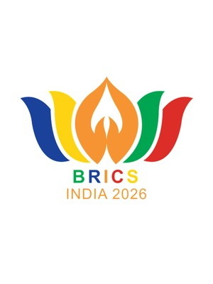</a>
  

  

    
Sponsored research

    
<strong>Resilient Global Value Chains (GVCs) to Promote Fair and Equitable Trade</strong>, as part of India’s BRICS Chairship 2026.

    
ISID’s knowledge partnership with the Department of Commerce, Ministry of Commerce and Industry, Government of India, under the <em>BRICS Contact Group on Economic and Trade Issues (CGETI)</em>. (Sponsored by Department of Commerce).

    
Team: Nagesh Kumar (Project Director), Reji K. Joseph (Focal Point, coordinating inputs between ISID and the Department of Commerce) and Isha Chawla.

    
Output: Contribution used in the <a href="https://d2jiw2zrmmyqt8.cloudfront.net/wp-content/uploads/2026/08/18114422/Chairs-statement-and-Outcome-document-7-august-2026.pdf">Chair’s Statement and Outcome Document of the Sixteenth Meeting of the BRICS Trade Ministers</a>, Jaipur, India, 7 August 2026.

  

<h2 id="p2023-present">2023–present</h2>

  

    <a href="https://isid.org.in/publication/reimagining-india-korea-economic-partnership-pathways-to-deeper-integration/">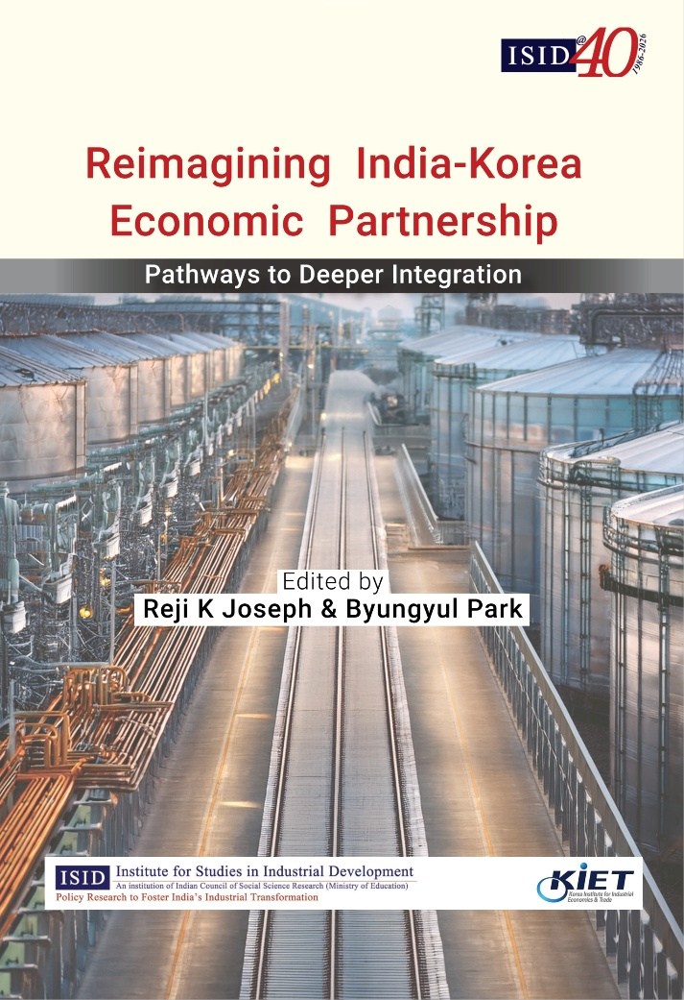</a>
    <a href="https://isid.org.in/publication/korea-india-industrial-collaboration-driving-shared-growth-and-future-prosperity/">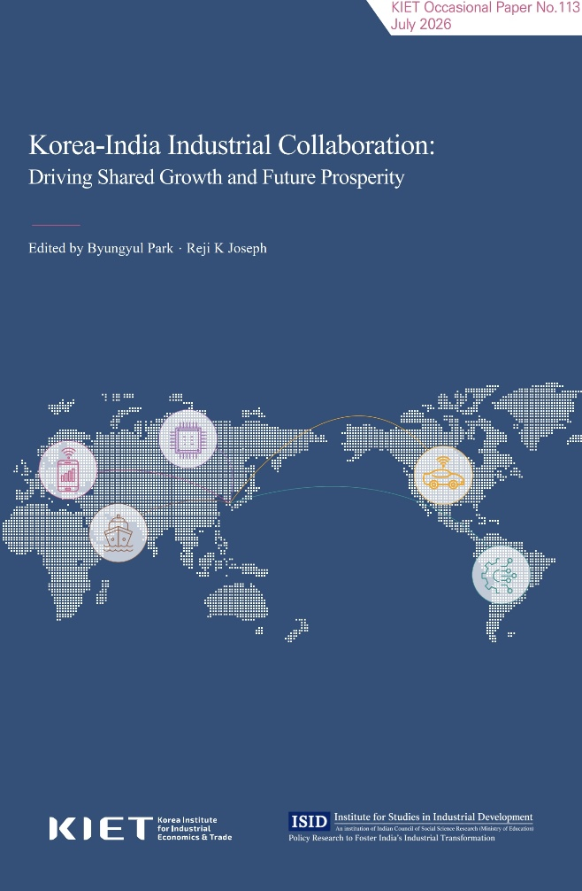</a>
  

  

    
<strong>Deepening India-Korea Economic Cooperation</strong>

    
A joint initiative of ISID and the Korea Institute for Industrial Economics and Trade (KIET), Sejong, Korea, to deepen the economic partnership between the two countries through collaborative research and policy advocacy.

    
Team: Nagesh Kumar (Director, ISID), Namhoon Kwon (President, KIET), Reji K. Joseph (Focal Point, ISID), Byungyul Park (Focal Point, KIET) and faculty members of both institutes.

    
Outputs: Two policy dialogues/forums involving the embassies of both countries and experts from academia and industry (New Delhi, 2024; Seoul, 2025); two edited books, <a href="https://isid.org.in/publication/reimagining-india-korea-economic-partnership-pathways-to-deeper-integration/"><em>Reimagining India-Korea Economic Partnership: Pathways to Deeper Integration</em></a> (2025) and <a href="https://isid.org.in/publication/korea-india-industrial-collaboration-driving-shared-growth-and-future-prosperity/"><em>Korea-India Industrial Collaboration: Driving Shared Growth and Future Prosperity</em></a> (2026); working papers and op-eds.

  

<h2 id="p2023-24">2023–24</h2>

  

    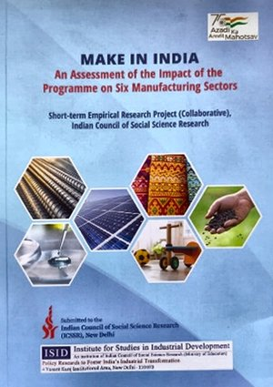
  

  

    
Sponsored research

    
<strong>Make in India: An Assessment of the Impact of the Programme on Six Manufacturing Sectors</strong> (Sponsored by Indian Council of Social Science Research).

    
Team: Reji K. Joseph (Project Coordinator; Project Director, Pharmaceutical Sector Study), Anjali Tandon, Beena Saraswathy, Ramaa Arun Kumar, Sangeeta Ghosh and Seenaiah Kale.

    
Output: A report submitted to ICSSR and a book being published by ICSSR and Macmillan (forthcoming).

  

<h2 id="p2023">2023</h2>

  

    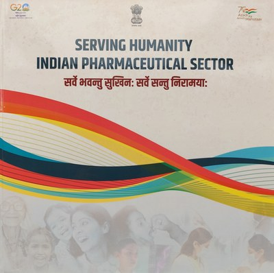
  

  

    
<strong>Coffee Table Book Showcasing the Story of Indian Generic Drugs</strong>, as part of India’s G20 Presidency, 2023.

    
Editorial Committee (constituted by the Department of Pharmaceuticals, Government of India): Kamlesh Kumar Pant (Chairman, National Pharmaceutical Pricing Authority, and Chairperson of the Committee), Vinod Kotwal (Member Secretary, National Pharmaceutical Pricing Authority), Sumit Garg (Deputy Secretary, Department of Pharmaceuticals), Archana Jatkar (Associate Secretary General, Indian Pharmaceutical Alliance), Ashok Madan (Executive Director, Indian Drug Manufacturers Association) and Reji K. Joseph (ISID).

    
Output: A book, <em>Serving Humanity: Indian Pharmaceutical Sector</em>, published by the Department of Pharmaceuticals, Government of India.

  

<h2 id="p2022-23">2022–23</h2>

  

    <a href="https://pharma-dept.gov.in/sites/default/files/Updated%20Strategy%20for%20Leveraging%20ASEAN%20FTA%20and%20trade%20potential%20with%20the%20Middle%20East%20Countries%20for%20Pharma%20Sector%20in%20India%20Final%20-%20ISID.pdf">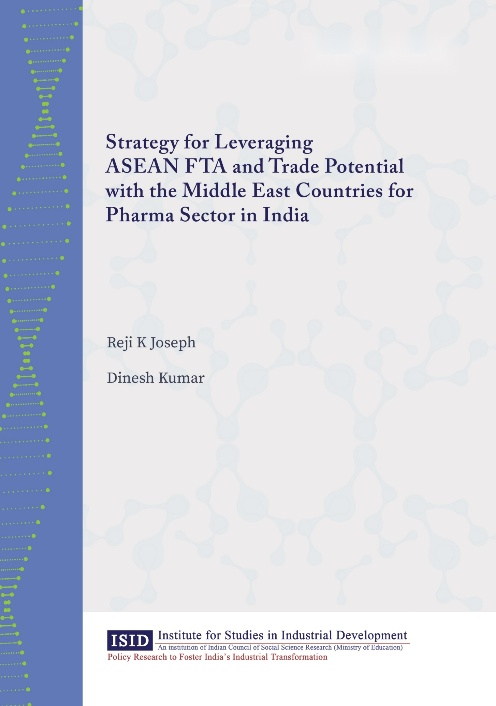</a>
  

  

    
Sponsored research

    
<strong>Strategy for Leveraging ASEAN FTA and Trade Potential with the Middle East Countries for Pharma Sector in India</strong> (Sponsored by Department of Pharmaceuticals, Government of India).

    
Team: Reji K. Joseph (Project Director) and Dinesh Kumar (Consultant).

    
Output: A <a href="https://pharma-dept.gov.in/sites/default/files/Updated%20Strategy%20for%20Leveraging%20ASEAN%20FTA%20and%20trade%20potential%20with%20the%20Middle%20East%20Countries%20for%20Pharma%20Sector%20in%20India%20Final%20-%20ISID.pdf">report</a> submitted to the Department of Pharmaceuticals.

  

<h2 id="p2022">2022</h2>

  

    <a href="https://www.nstmis-dst.org/NMIS/assets/pdf/Assessment%20of%20Firm-Level%20Innovation%20in%20Indian%20Manufacturing.pdf">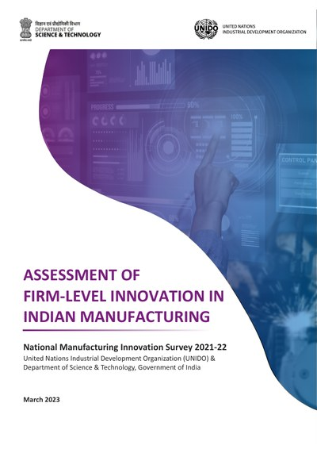</a>
  

  

    
Sponsored research

    
<strong>Innovation in the Indian Industry: A Macro Scenario</strong>, as part of the Department of Science and Technology (DST), Government of India and UNIDO project on <em>National Manufacturing Innovation Survey 2021</em>. (Sponsored by United Nations Industrial Development Organization).

    
Role: Project Director.

    
Output: Used in preparing the technical chapters of the DST-UNIDO report <a href="https://www.nstmis-dst.org/NMIS/assets/pdf/Assessment%20of%20Firm-Level%20Innovation%20in%20Indian%20Manufacturing.pdf"><em>Assessment of Firm-Level Innovation in Indian Manufacturing</em></a> (2023).

  

<h2 id="p2021">2021</h2>

  

    <a href="https://isid.org.in/wp-content/uploads/2022/07/WP239.pdf">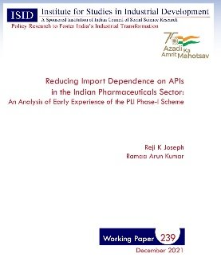</a>
    <a href="https://journals.sagepub.com/doi/full/10.1177/00194662241265475">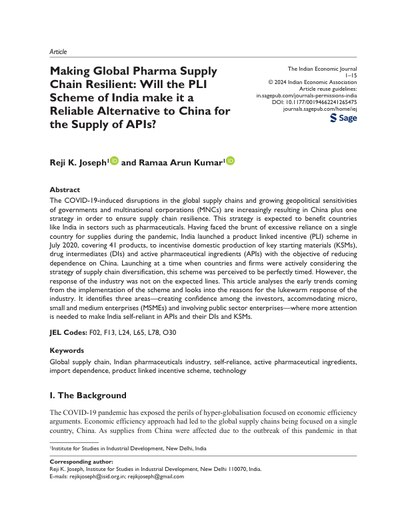</a>
  

  

    
<strong>Reducing Import Dependence on APIs: Early Experience of the PLI Scheme</strong>

    
Team: Reji K. Joseph (Project Director) and Ramaa Arun Kumar (Co-Director).

    
Outputs: <a href="https://isid.org.in/wp-content/uploads/2022/07/WP239.pdf">ISID Working Paper 239</a>, an <a href="https://journals.sagepub.com/doi/full/10.1177/00194662241265475">article in the <em>Indian Economic Journal</em></a> and op-eds.

  

<h2 id="p2019-20">2019–20</h2>

  

    <a href="https://isid.org.in/wp-content/uploads/2022/07/WP214.pdf">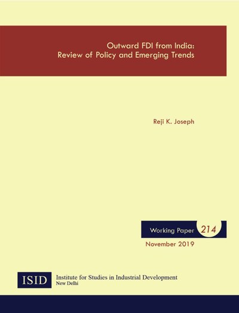</a>
    <a href="https://isid.org.in/wp-content/uploads/2022/07/WP229.pdf">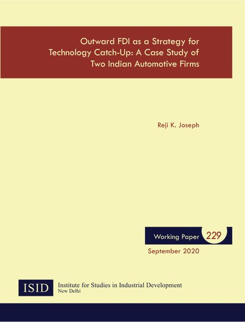</a>
  

  

    
Sponsored research

    
<strong>Outward FDI from India</strong>, under the research programme <em>Industrial, Trade and Investment Policies: Pathways to India’s Industrialisation</em>. (Sponsored by Indian Council of Social Science Research).

    
Team: M.R. Murty (Programme Director), T.P. Bhat (Co-Director), Reji K. Joseph (Project Director, OFDI Studies), Beena Saraswathy, Mahua Paul, Ramaa Arun Kumar, Santosh Kumar Das, H. Ramachandran, Surya Tewari, Satyaki Roy, Sanjaya Kumar Malik, K.S. Chalapati Rao, Biswajit Dhar, Smitha Francis, Anjali Tandon, R. Rijesh, K.V.K. Ranganathan, Priyanka Tiwari and Swati Verma.

    
Outputs: A report submitted to ICSSR and ISID Working Papers 214, <a href="https://isid.org.in/wp-content/uploads/2022/07/WP214.pdf"><em>Outward FDI from India: Review of Policy and Emerging Trends</em></a>, and 229, <a href="https://isid.org.in/wp-content/uploads/2022/07/WP229.pdf"><em>Outward FDI as a Strategy for Technology Catch-Up: A Case Study of Two Indian Automotive Firms</em></a>.

  

<h2 id="p2018-19">2018–19</h2>

  

    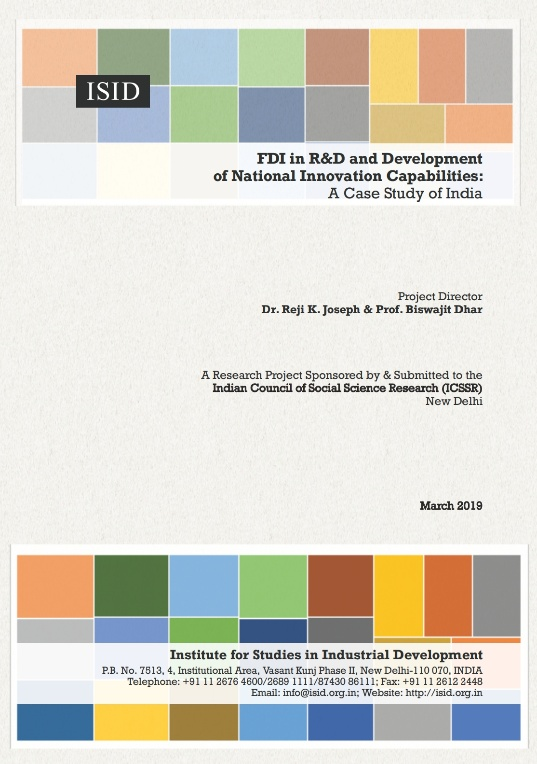
    <a href="https://isid.org.in/wp-content/uploads/2022/09/WP209.pdf">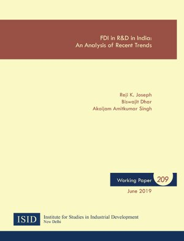</a>
  

  

    
Sponsored research

    
<strong>FDI in R&amp;D and Development of National Innovation Capabilities: A Case Study of India</strong> (Sponsored by Indian Council of Social Science Research).

    
Team: Reji K. Joseph (Project Director), Biswajit Dhar (Co-Director) and Akoijam Amitkumar Singh (Research Assistant).

    
Outputs: A report submitted to ICSSR and <a href="https://isid.org.in/wp-content/uploads/2022/09/WP209.pdf">ISID Working Paper 209</a>.

  

<h2 id="p2017-18">2017–18</h2>

  

    <a href="https://link.springer.com/book/10.1007/978-981-13-8102-7">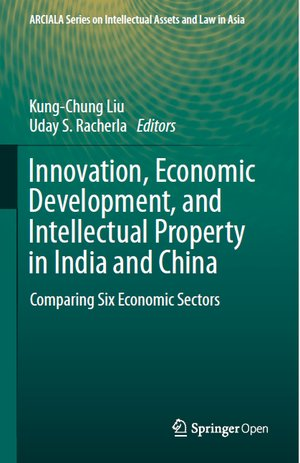</a>
  

  

    
Sponsored research

    
<strong>Indian Pharmaceutical Industry</strong> and <strong>IT Industry</strong>, under the project <em>Innovation, Economic Development and IP in India and China</em>. (Sponsored by Max Planck Institute for Innovation and Competition, Germany, in collaboration with the Applied Research Centre for Intellectual Assets and the Law in Asia, Singapore Management University).

    
Team: Biswajit Dhar (Project Director) and Reji K. Joseph (Co-Director).

    
Output: Two chapters, <a href="https://link.springer.com/chapter/10.1007/978-981-13-8102-7_13"><em>The Challenges, Opportunities and Performance of the Indian Pharmaceutical Industry Post-TRIPS</em></a> and <a href="https://link.springer.com/chapter/10.1007/978-981-13-8102-7_5"><em>India’s Information Technology Industry: A Tale of Two Halves</em></a>, in a book (2019).

  

<h2 id="p2009">2009</h2>

  

    <a href="https://wtocentre.iift.ac.in/Books/Trade%20Barrier%20Report.pdf">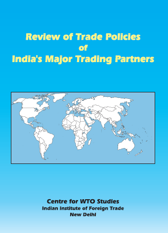</a>
  

  

    
<strong>Review of Trade Policies of India’s Major Trading Partners</strong>

    
Team: Shashank Priya (Project Director) and Reji K. Joseph (Co-Director).

    
Output: A <a href="https://wtocentre.iift.ac.in/Books/Trade%20Barrier%20Report.pdf">report published by the Centre for WTO Studies</a> (2009), Indian Institute of Foreign Trade, New Delhi.

  

